# 地狱也得下班

**17:59，电梯门开了。** 门外是一座熔岩地府。加急文件从打印机里飞出来，审批章砸在必经的桥上，出口还等着最后一次打卡。

这是黄花鱼 AIGC 为 Aholo 黑客松制作的单人 3D 闯关游戏。选锅仔，用铁锅把来袭的飞锅弹回去；选椅哥，放低椅背从锅底下滑过；选小默，让替身吸引火力，自己绕过去。三位同事走同一条下班路，各有各的活法。

**[下载 Windows 试玩包 · v011（853 MB）](https://github.com/huangxin-design/after-hours-hell-godot/releases/download/v011/AfterHoursHell-Windows-v011.zip)**　·　[浏览 3D 游戏资产](#第一层的-19-件-3d-资产)　·　[AI 游戏开发复盘与原创 Skill](#项目组原创-skill)

## 开场 CG · 下班，走这边

三位同事等到了下班铃。电梯门一开，面前却是一座通往地府的桥。

| 下班，走这边 | 下班铃响 · 通道开启 |
| :--- | :--- |
| [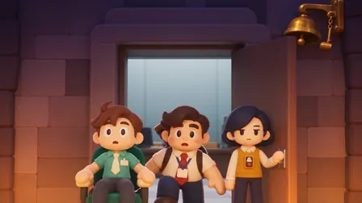](https://github.com/huangxin-design/after-hours-hell-godot/releases/download/cg-20261119/AfterHoursHell-Bridge.mp4) | [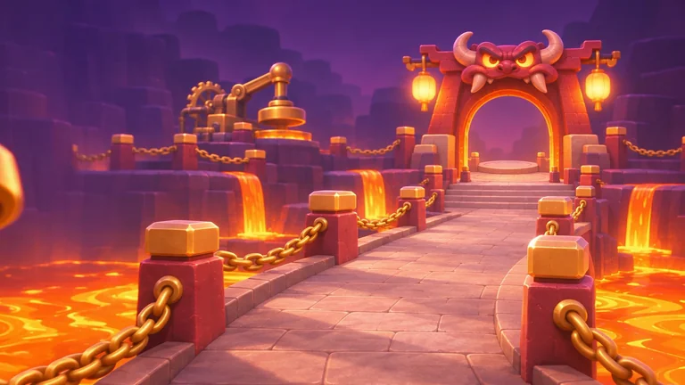](https://github.com/huangxin-design/after-hours-hell-godot/releases/download/cg-20261119/AfterHoursHell-Bell.mp4) |
| [下载桥头字幕版 · 28 秒 MP4](https://github.com/huangxin-design/after-hours-hell-godot/releases/download/cg-20261119/AfterHoursHell-Bridge.mp4) | [下载通道短片 · 5 秒 MP4](https://github.com/huangxin-design/after-hours-hell-godot/releases/download/cg-20261119/AfterHoursHell-Bell.mp4) |

## 试玩第一层「油锅地狱」

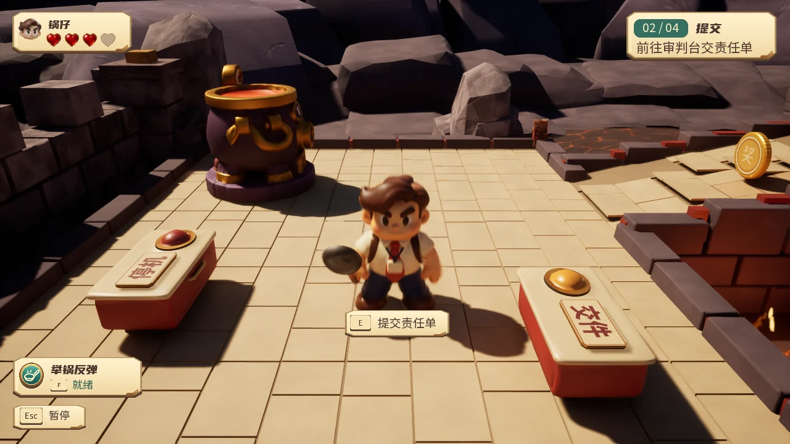

| 选一位下班搭子 | 穿过返程打卡闸 |
| :--- | :--- |
|  |  |

*以上为 Unreal Engine 的 v012 开发版实机截图。当前公开试玩为 v011。*

**怎么玩**　完整解压试玩包后，双击 `窗口试玩 1280x720.cmd` 或 `4K 全屏试玩.cmd`。WASD 移动，鼠标转视角，空格跳跃，F 使用角色技能，E 与场景互动。

## 第一层的 19 件 3D 资产

我们用群核 Lux3D 为第一层生成了 25 份底模，在 Blender 中修整，再把角色、建筑和道具接入 Unreal Engine。下面收录 19 种造型，包括早期试作的审批印章。下载包里的 GLB 和白模渲染来自同一份修整稿。

### 人物 · 三位下班搭子

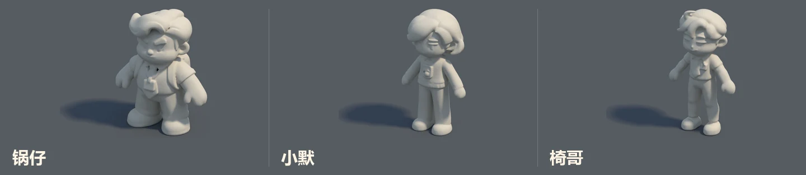

**角色技能 CG · 子弹时间**　同一发来袭的弹丸，三个人各有一招。点击下方画面可下载对应的 10 秒有声短片。

| 锅仔 · 举锅反弹 | 椅哥 · 躺平闪避加速 | 小默 · 替身诱敌 |
| :--- | :--- | :--- |
| [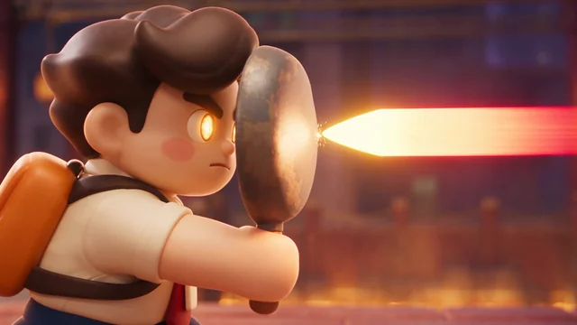](https://github.com/huangxin-design/after-hours-hell-godot/releases/download/cg-20261119/AfterHoursHell-Guozai.mp4) |  | [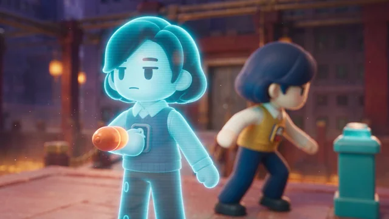](https://github.com/huangxin-design/after-hours-hell-godot/releases/download/cg-20261119/AfterHoursHell-Xiaomo.mp4) |

### 场景 · 用四种构件拼出关卡

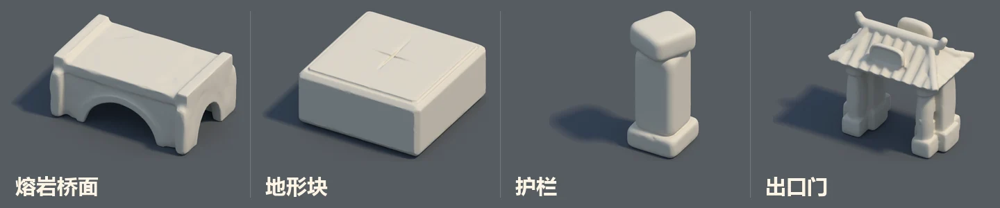

### 道具 · 十二件装备与办公室机关

**[下载 19 件 3D 资产 · GLB 模型与渲染原图（107 MB）](https://github.com/huangxin-design/after-hours-hell-godot/releases/download/art-20261119/AfterHoursHell-3D-Gallery.zip)**

每件附中文名称、生成任务号和对应的 PNG。另收录两张关卡组合图。早期的 [Godot 规则原型](examples/godot-rules/)也保存在仓库里。

## 美术设定 · 角色、机关与游戏 UI

### 角色三视图 · 转过身也认得出

锅仔背着双肩包，小默胸前挂着工牌，椅哥的发梢总是向上翘。画正面、侧面与背面时，我们把这些小细节留在了同一个位置。

### 机关三视图 · 出纸口和闸杆指向哪里

看到打印机的出纸口，就知道文件会从哪里飞出来；看到打卡闸的长杆，就知道要等它扫过再走。三视图先把这些方向画清楚，再交给建模。

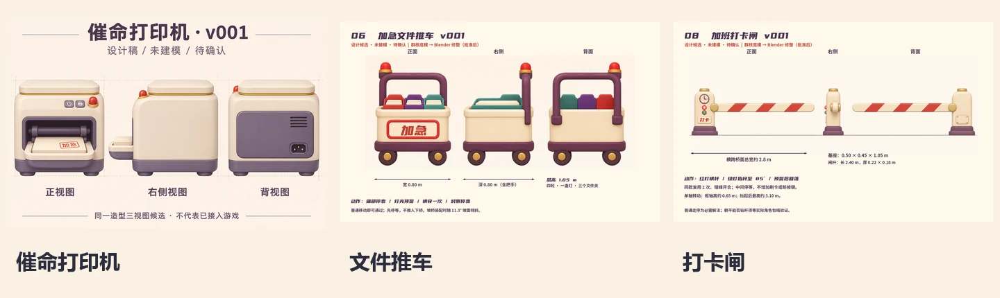

### 游戏 UI · 暂停用夹板，领奖用回执

按下暂停，眼前是一块夹着纸页的办公夹板。领到奶茶，出现的是盖过章的回执，杯盖和吸管的轮廓沿用了关卡里的 3D 模型。

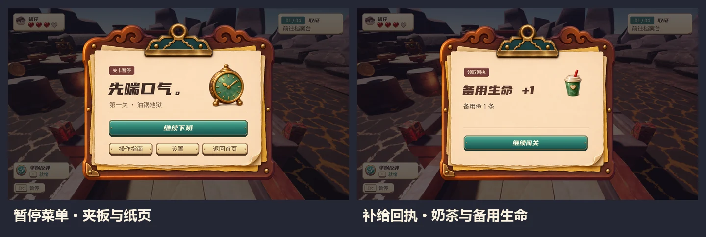

**[下载美术设定集 · 人物、道具与游戏 UI（50 MB）](https://github.com/huangxin-design/after-hours-hell-godot/releases/download/art-20261119/AfterHoursHell-Design-Kit.zip)**

3 份人物三视图、4 份道具三视图、8 张界面设定和 12 枚透明 PNG 图标。

## 把下班搭子放上书桌

锅仔在游戏里要握得住锅柄，做成摆件后，还得靠脚底和底座站稳。我们给锅仔、椅哥和小默分别做了 150 mm 的打印模型。

*锅仔的 Blender 虚拟陈列。包装为概念稿，实体效果待试打。*

[下载三位角色的 STL、3MF 和逐件试打说明（42 MB，附奶茶 GLB）](https://github.com/huangxin-design/after-hours-hell-godot/releases/download/v011/AfterHoursHell-Models-v011.zip) · [读创作者手记](docs/creator-notes.md) · [素材使用说明](RIGHTS.md)

## 项目组原创 Skill

**这份 Codex Skill 是我们根据开发《地狱也得下班》时踩过的坑，自己整理编写的。** 我们把当时如何复现问题、该看哪一帧、怎样确认修好都写了下来，供其他 3D 游戏开发者复用。

| 文件掠过头顶时，椅哥躲开了吗？ | 飞出的纸包对得上打印机托盘吗？ |
| :--- | :--- |
| [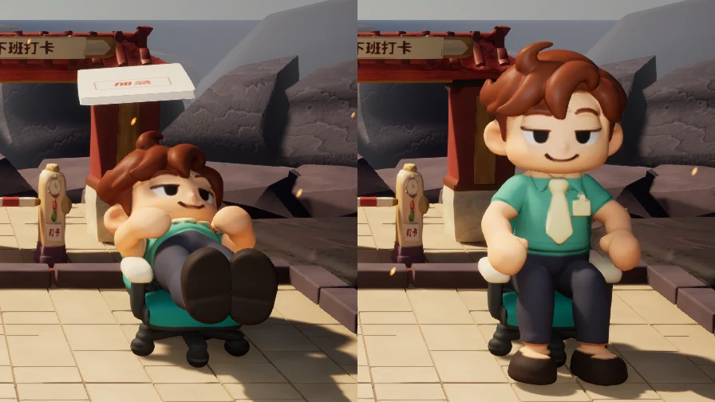](docs/gallery/yige-dodge-v013.webp) | [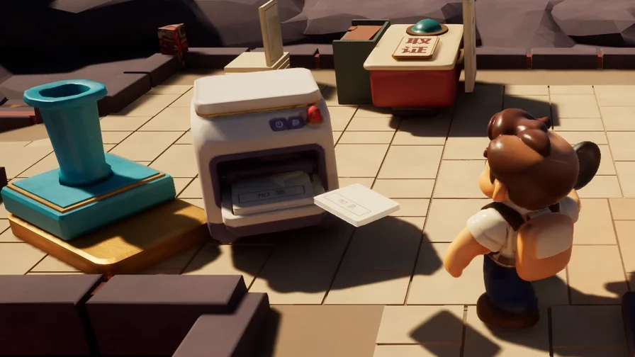](docs/gallery/printer-ejection-v012.webp) |
| **v013 · 虚幻引擎选角演示** 左图看文件与头顶的空隙，右图看椅哥坐回去时，身体和椅背能否对上。[查看角色绑定记录](docs/lux3d/characters.md) | **v012 · 虚幻引擎关卡实录** 在第 16.6 秒暂停，纸包刚离开托盘。顺着出纸口看，就能判断它会飞向桥面的哪一侧。[查看打印机制作记录](docs/lux3d/deadline-printer.md) |

[阅读五个开发踩坑案例](skills/ai-3d-game-qa/references/after-hours-case.md) · **[查看项目组原创 Skill · AI 3D 游戏接入排查](skills/ai-3d-game-qa/SKILL.md)**

将 `ai-3d-game-qa` 目录放入 Codex 的 Skills 目录后，可用 `$ai-3d-game-qa` 调用。

## 特别鸣谢

| <picture><source media="(prefers-color-scheme: dark)" srcset="docs/gallery/aholo-dark.png"></picture> |  |
| :---: | :---: |
| 感谢群核提供 3D 算力支持 | 感谢 AGI Bar 提供模型算力支持 |
