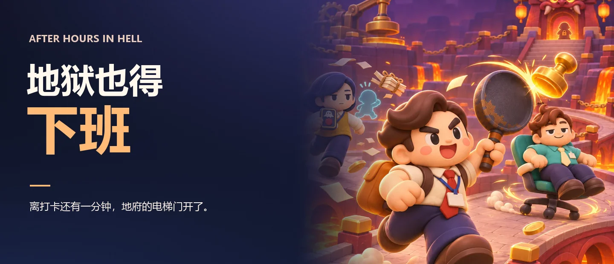
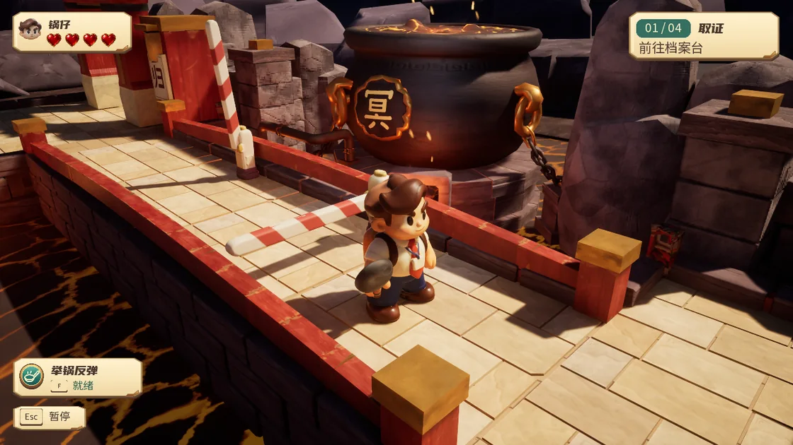
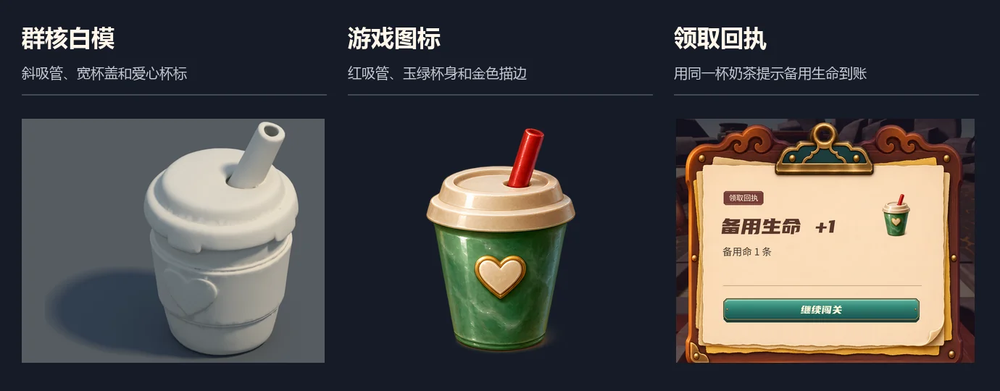

# 地狱也得下班 · After Hours in Hell

17:59，电梯门开了。办公室通向一座熔岩地府。打印机吐出加急文件，印章砸在必经的桥上。选一位同事，拿到凭证，想办法准点下班。

**[下载 Windows 试玩版 v011](https://github.com/huangxin-design/after-hours-hell-godot/releases/download/v011/AfterHoursHell-Windows-v011.zip)**　·　[下载模型与打印文件](https://github.com/huangxin-design/after-hours-hell-godot/releases/download/v011/AfterHoursHell-Models-v011.zip)　·　[阅读制作手记](docs/creator-notes.md)

## 先玩一关

**锅仔**能把飞锅弹回去，**椅哥**能放低椅背从下面穿过，**小默**能让替身留在原地吸引攻击。同一道机关，换一个人，就得换一个出手时机。

下载后完整解压 ZIP，双击根目录的 `窗口试玩 1280x720.cmd`，或选择 `4K 全屏试玩.cmd`。用 WASD 移动、鼠标转动视角、空格跳跃、F 释放角色技能、E 与场景互动。[版本说明与文件校验值](https://github.com/huangxin-design/after-hours-hell-godot/releases/tag/v011)

*第一层「油锅地狱」 · Unreal Engine 5.8.4 · Windows v011 实机画面*

## 从群核白模到游戏资产

同一杯下班奶茶，在关卡里能绕着看，在界面里只有几十个像素大。我们保留斜吸管、宽杯盖和爱心杯标，让玩家在领取备用生命的瞬间也能认出它。

| 想看什么 | 从这里开始 |
| --- | --- |
| 从提示词到可用的道具 | [催命打印机：三视图、Blender 修整、拆分飞行纸包](docs/lux3d/deadline-printer.md) |
| 从静态角色到能读懂的技能 | [锅仔的手掌、椅哥的椅背和小默的替身](docs/lux3d/characters.md) |
| 从游戏角色到桌面摆件 | [三名角色的 150 mm 打印文件与试打说明](docs/creator-notes.md#通关用过的角色怎样留在桌上) |

## 开发者入口

游戏从 Godot 原型发展到 Unreal Engine。仓库保留了早期原型的一段可运行规则示例，完整 Windows 试玩包和可下载模型按版本放在 Releases。

[Godot 规则示例](examples/godot-rules/) · [构建与版本说明](docs/build-and-run.md) · [机器可读索引](project.json) · [素材使用范围](RIGHTS.md) · [制作回忆册](https://after-hours-18-progress.meoworangecat.chatgpt.site/#memories)

黄花鱼 AIGC 制作 · Aholo 黑客松参赛作品
