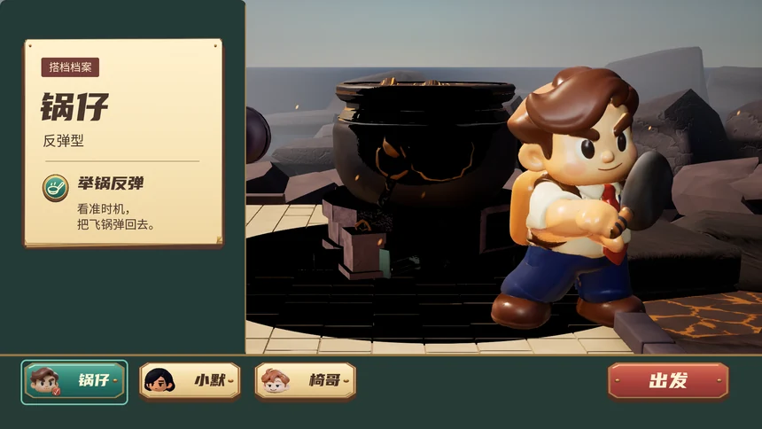
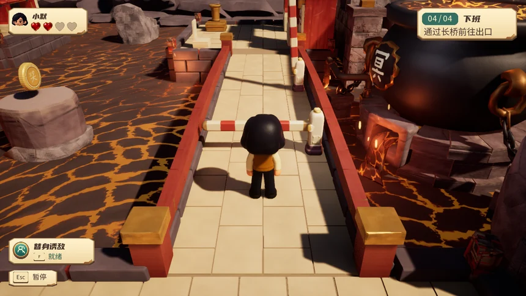
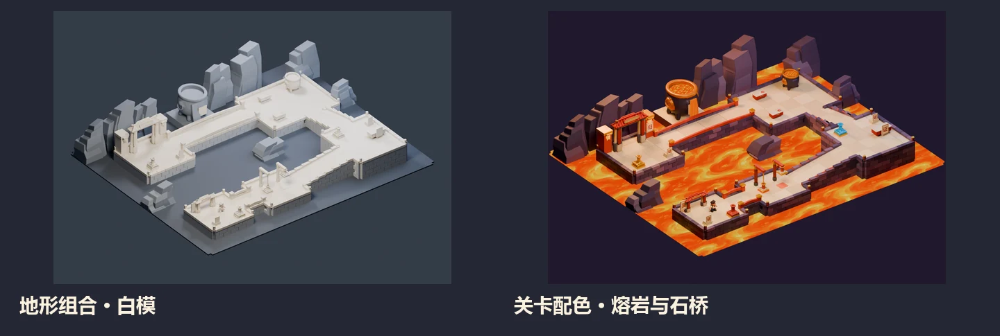
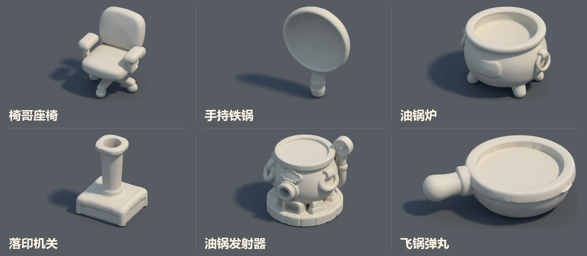
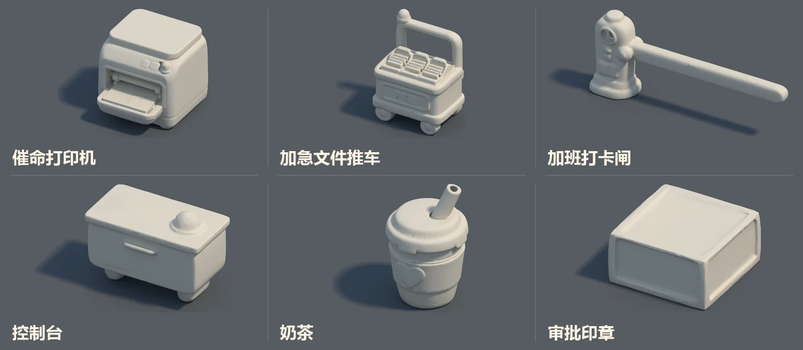
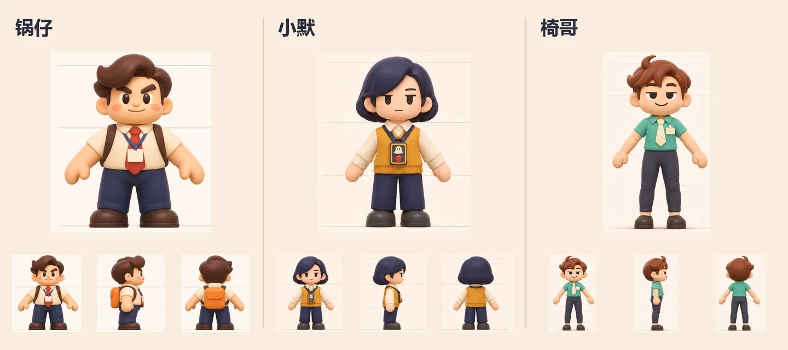

# 地狱也得下班

17:59，电梯门开了。门外是一座熔岩地府：加急文件从打印机里飞出来，审批章砸在必经的桥上，出口还等着最后一次打卡。

这是黄花鱼 AIGC 为 Aholo 黑客松制作的单人 3D 闯关游戏。选锅仔，用铁锅把来袭的飞锅弹回去；选椅哥，放低椅背从锅底下滑过；选小默，让替身吸引火力，自己绕过去。三位同事走同一条下班路，各有各的活法。

想了解 **AI 游戏开发**（AI-assisted game development）和 **3D 游戏制作**（3D game development），这里也有一条实际工作流。群核 Lux3D 生成底模，Blender 修整资产，Unreal Engine 接入玩法。仓库保留了早期 Godot 规则原型。

## 游戏截图

| 选一位下班搭子 | 穿过返程打卡闸 |
| :--- | :--- |
|  |  |

*以上为 Unreal Engine 的 v012 开发版实机截图。当前公开试玩为 v011。*

**[下载 Windows 试玩包 · v011（853 MB）](https://github.com/huangxin-design/after-hours-hell-godot/releases/download/v011/AfterHoursHell-Windows-v011.zip)**

完整解压后，双击 `窗口试玩 1280x720.cmd` 或 `4K 全屏试玩.cmd`。WASD 移动，鼠标转视角，空格跳跃，F 使用角色技能，E 与场景互动。

## 3D 资产图录

制作第一层时，我们用群核 Lux3D 生成了 25 份角色、建筑与道具底模。这里收录 19 种造型，包括早期试作的审批印章。下载包里的 GLB 和下面的白模渲染来自同一份 Blender 修整稿。

### 三位同事

### 搭起第一层的四件建筑

### 十二件随身装备、机关与办公道具

**[下载 19 件 3D 资产 · GLB 模型与渲染原图（107 MB）](https://github.com/huangxin-design/after-hours-hell-godot/releases/download/art-20261119/AfterHoursHell-3D-Gallery.zip)**

每件附中文名称、生成任务号和对应的 PNG。另收录两张关卡组合图。

[下载三位角色的 150 mm 打印文件及奶茶游戏模型（42 MB）](https://github.com/huangxin-design/after-hours-hell-godot/releases/download/v011/AfterHoursHell-Models-v011.zip) · 内含 STL、3MF 和逐件试打说明。

## 人物、道具与游戏 UI 设定

### 人物怎样从不同角度被认出来

锅仔背着双肩包，小默胸前挂着工牌，椅哥的发梢总是向上翘。画正面、侧面与背面时，我们把这些小细节留在了同一个位置。

### 道具的轮廓怎样提示玩法

看到打印机的出纸口，就知道文件会从哪里飞出来；看到打卡闸的长杆，就知道要等它扫过再走。三视图先把这些方向画清楚，再交给建模。

### 让菜单也像地府办公室的文件

按下暂停，眼前是一块夹着纸页的办公夹板。领到奶茶，出现的是盖过章的回执，杯盖和吸管的轮廓沿用了关卡里的 3D 模型。

**[下载美术设定集 · 人物、道具与游戏 UI（50 MB）](https://github.com/huangxin-design/after-hours-hell-godot/releases/download/art-20261119/AfterHoursHell-Design-Kit.zip)**

3 份人物三视图、4 份道具三视图、8 张界面设定和 12 枚透明 PNG 图标。

[读创作者手记](docs/creator-notes.md) · [看催命打印机的制作过程](docs/lux3d/deadline-printer.md) · [看三位角色的动作绑定](docs/lux3d/characters.md) · [素材使用说明](RIGHTS.md)

## 开发踩坑复盘与 Codex Skill

选角卡片只在第一帧闪、椅哥一后仰就离开椅背、机关能单独运行却走不完整关。我们把这些容易漏掉的检查整理成一份 Skill，能按现象找到对应的检查点、复现步骤和验收证据。

- [读《地狱也得下班》开发踩坑复盘](skills/ai-3d-game-qa/references/after-hours-case.md)
- [查看 AI 3D 游戏接入排查 Skill](skills/ai-3d-game-qa/SKILL.md)。将 `ai-3d-game-qa` 目录放到 Codex 的 Skills 目录后，可用 `$ai-3d-game-qa` 调用。

## 特别鸣谢

| <picture><source media="(prefers-color-scheme: dark)" srcset="docs/gallery/aholo-dark.png"></picture> |  |
| :---: | :---: |
| 感谢群核提供 3D 算力支持 | 感谢 AGI Bar 提供模型算力支持 |
