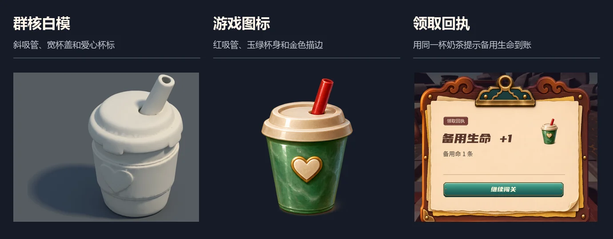
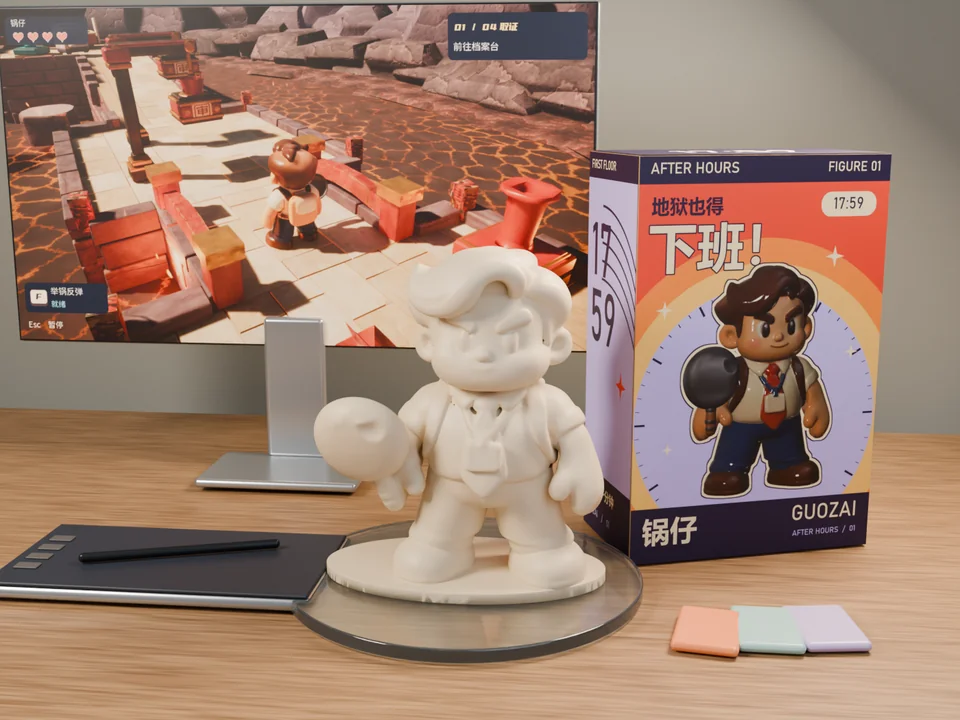

# 我是怎么把办公室做成一关游戏的

*黄花鱼 AIGC · 根据制作过程中的讨论整理，问题与回答均经过编辑。*

## 为什么偏偏是下班前一分钟

**问**　办公室里的梗很多，你怎么挑哪些做成玩法？

**答**　我挑那些会让人迟疑一下的瞬间。包都收好了，有人又说“再开个短会”。文件写着加急，你得决定先处理哪一件。做游戏时，我想把那个决定交还给玩家。于是加急文件真的会从打印机里飞出来。看到出纸口，玩家可以预判方向，再决定走还是等。

**做法**　给道具写一个玩家能观察到的信号，再写一个他能采取的动作。打印机的信号是出纸口，动作是提前让开；打卡闸的信号是横杆的位置，动作是等它扫过再走。[打印机从设计稿到关卡机关](lux3d/deadline-printer.md)

## 一杯奶茶怎样在两个地方都认得出

**问**　怎么讲清楚群核模型跟游戏 UI 的关系？

**答**　我最后选了奶茶。把它的白模和图标并排，谁都可以自己核对。白模给出了杯盖的宽度、吸管的倾斜方向，还有正面的爱心；图标把杯身换成玉绿色，边缘提成金色。领取回执里只有一枚小图，玩家仍然能认出来。

**做法**　把“必须保留的造型”和“可以统一调整的材质”分别记下来，用作下一批 UI 的设计风格规则。最后把图标放回实际显示尺寸，看最小的那一枚还能不能认出来。模型包里有这件道具的 GLB 和对应 PNG，可以自己对照。[下载模型样本](https://github.com/huangxin-design/after-hours-hell-godot/releases/download/v011/AfterHoursHell-Models-v011.zip)

## 怎样让人一眼看懂角色用了技能

**问**　三人都做了动作，要看哪一帧才知道动作说清楚了？

**答**　我会盯着角色和道具接触的地方。锅仔挥锅，先看手掌和锅柄有没有一起转；椅哥后仰，看椅背有没有接住肩颈；小默施放替身，看本体离开以后，玩家还能不能分出谁留在了原地。三个问题，比三张好看的站姿更能说明绑定做到哪一步。

**做法**　保留起手、动作幅度最大、收势三帧，固定机位看接触点。随后再回到关卡镜头，看动作缩小后还清不清楚。[三角色动作图解及版本记录](lux3d/characters.md)

## 通关用过的角色怎样留在桌上

**问**　游戏里的锅仔已经有了模型，为什么做摆件还要再处理？

**答**　在游戏里，我关心锅柄能否跟上手；到了桌上，我关心锅仔能否站稳。我们保留角色的姿态，把足底与底座连起来，按 150 mm 的成品高度导出了打印候选。让我舍不得放下这件事的，是有玩家真的问过，这些小人能不能分享。

*Blender 虚拟陈列。盒子是包装概念，实体成品仍待试打。*

**拿到文件后**　模型包内有锅仔、小默、椅哥各一组 STL 与 3MF，以及逐件打印说明。请按毫米导入，以 150 mm 总高核对比例，再检查支撑和局部薄壁。游戏版奶茶和桌面摆件分目录放置，方便按用途取用。

[返回项目首页](../README.md) · [查看版本下载](https://github.com/huangxin-design/after-hours-hell-godot/releases/tag/v011)
