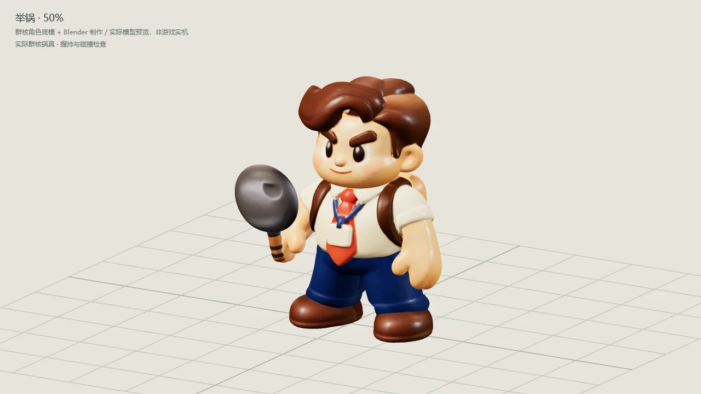
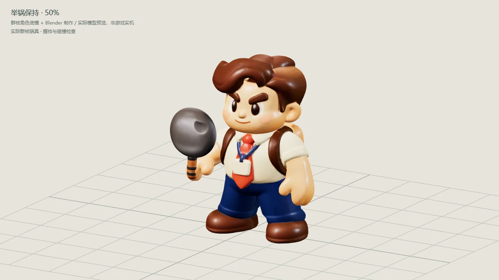
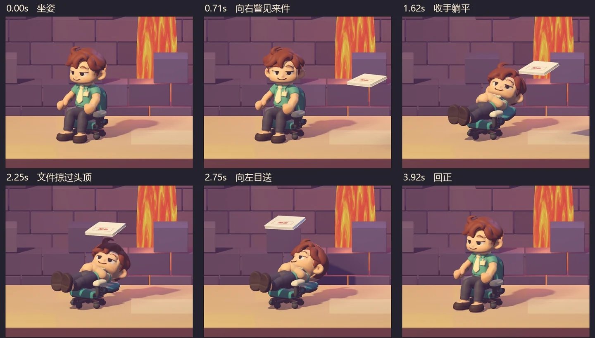
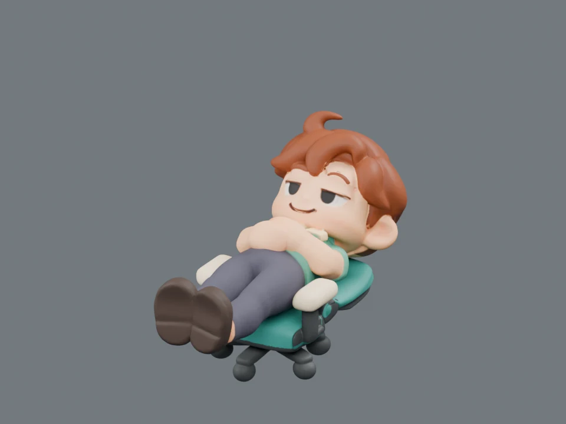
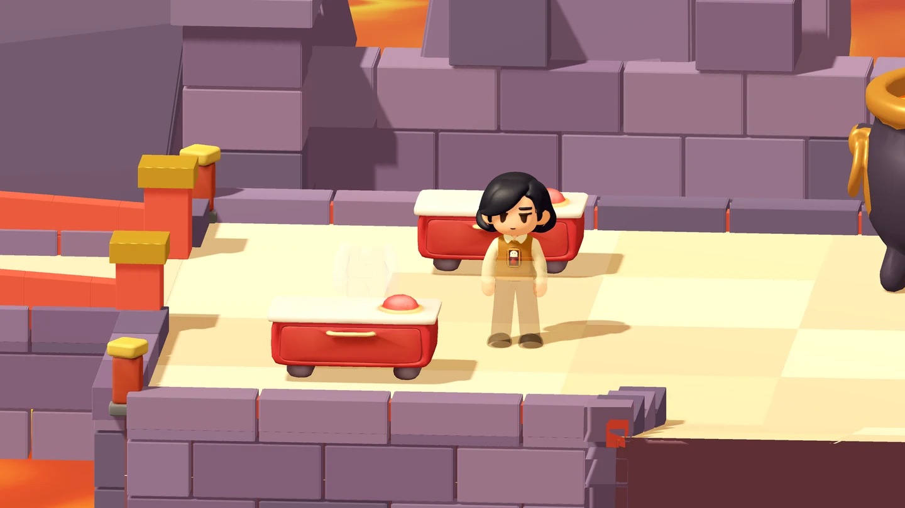

# 锅仔、椅哥、小默的角色动作

在第一层，同一叠飞来的加急文件给三个角色出了三道不同的动作题。锅仔要把锅举到来袭方向，椅哥要让人一眼看出他已躺平，小默则要让玩家分辨谁挨了这一下。11 月 16 日的 Godot 候选工程已包含三人的模型和对应机关逻辑。以下图片沿用各自制作版本，方便追溯每个动作是怎么做出来的。

## 锅仔 · 手掌和锅柄能否一起转

Lux3D 分别生成角色和铁锅，任务号为 `4706960` 和 `4744010`。在 Blender 的 `held-pan-v003` 持锅版本中，锅柄跟随右手挂点 `PropSocket_Pot_R`。用同一机位抽看三个动作，再从正面检查锅柄与手掌的关系。[正面握持检查图](images/guozai-grip.webp)

| 举锅进入防御 | 保持防御 | 反弹动作 |
| --- | --- | --- |
|  |  |  |

三张图各取对应动作的中段，展示资产姿态。坡顶机关的逻辑会把挡住的纸包调头送回打印机；击中卡纸点后，机器暂停出纸。玩家在镜头里能否看准举锅时机，还要结合移动画面判断。

## 椅哥 · 躺平后仍要看得出椅子和人

角色和椅子分别来自 Lux3D 任务 `4701063`、`4701632`。选角动作 `Yige_Select_File_Dodge` 的连续取样能看出人物怎样随椅背倾倒、再坐起。右图单独检查 E2 版本躺平后的姿态；该套战斗动作和材质已接入 11 月 7 日候选。

| 选角动作分解，selection-v001 | E2 躺平姿态，Blender 预览 |
| --- | --- |
|  |  |

坡顶机关另有躺平避开纸包、成功后加速的判定。左图取自选角演示，关卡内的时机需要用同版试玩录像说明。

## 小默 · 替身挨打时，本体在哪里

角色底模、重拓扑和绑定分别对应 Lux3D 任务 `4706027`、`4706129`、`4720902`。在 Blender 调整肩肘的蒙皮权重后，抬手按胸牌时腋下轮廓的下垂减轻，胸牌仍贴在胸前。技能让本体离开原位，留下替身吸引攻击。

这是 11 月 7 日留存的 Godot GPU 命中取样，对应记录里替身受击、本体生命值未下降。11 月 16 日工程里的纸包也有命中替身的分支。两次记录的版本和攻击来源应分开看。

本页提供动作与关卡画面的展示副本。原模、骨架、动作工程和运行网格的使用授权按件确认。[素材使用条件](../../RIGHTS.md) · [坡顶打印机案例](deadline-printer.md) · [返回首页](../../README.md)
