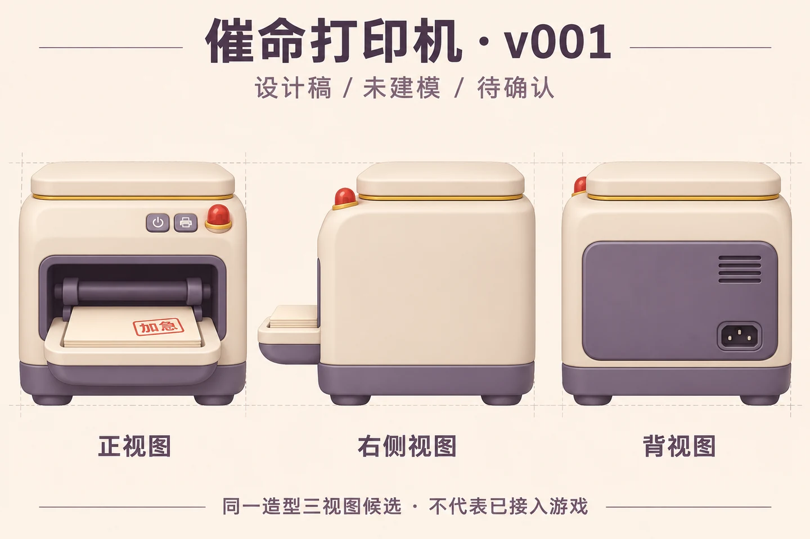
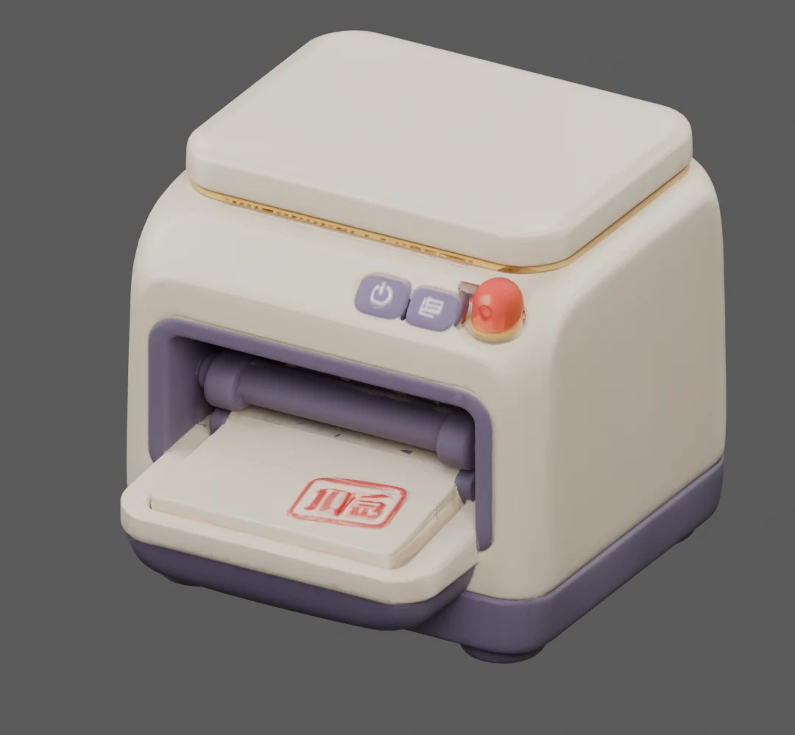
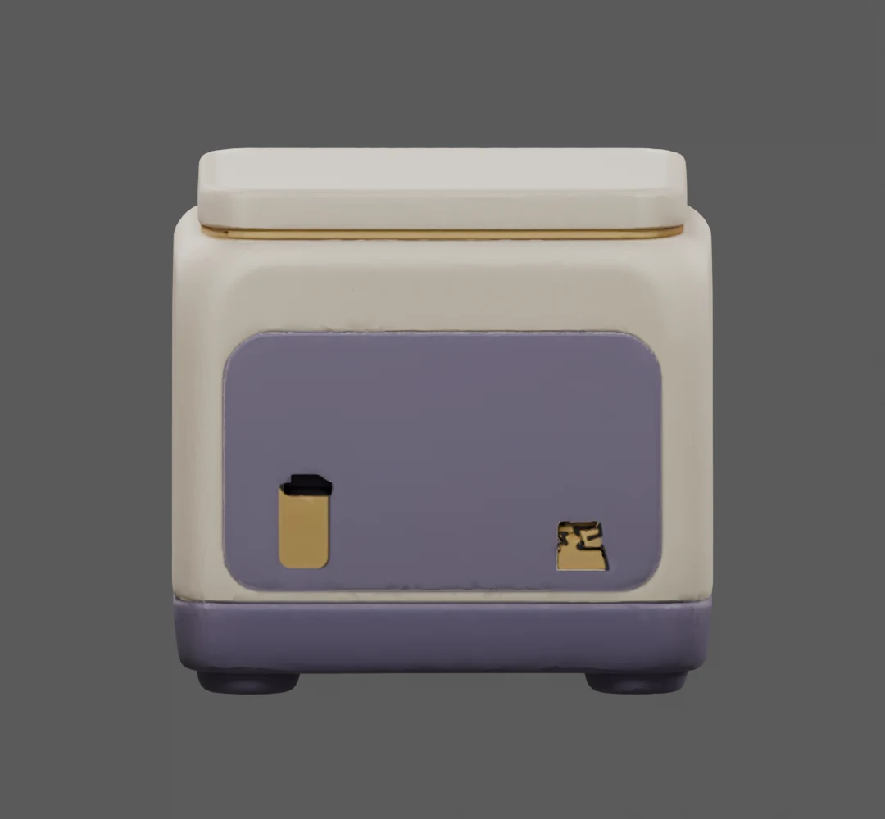
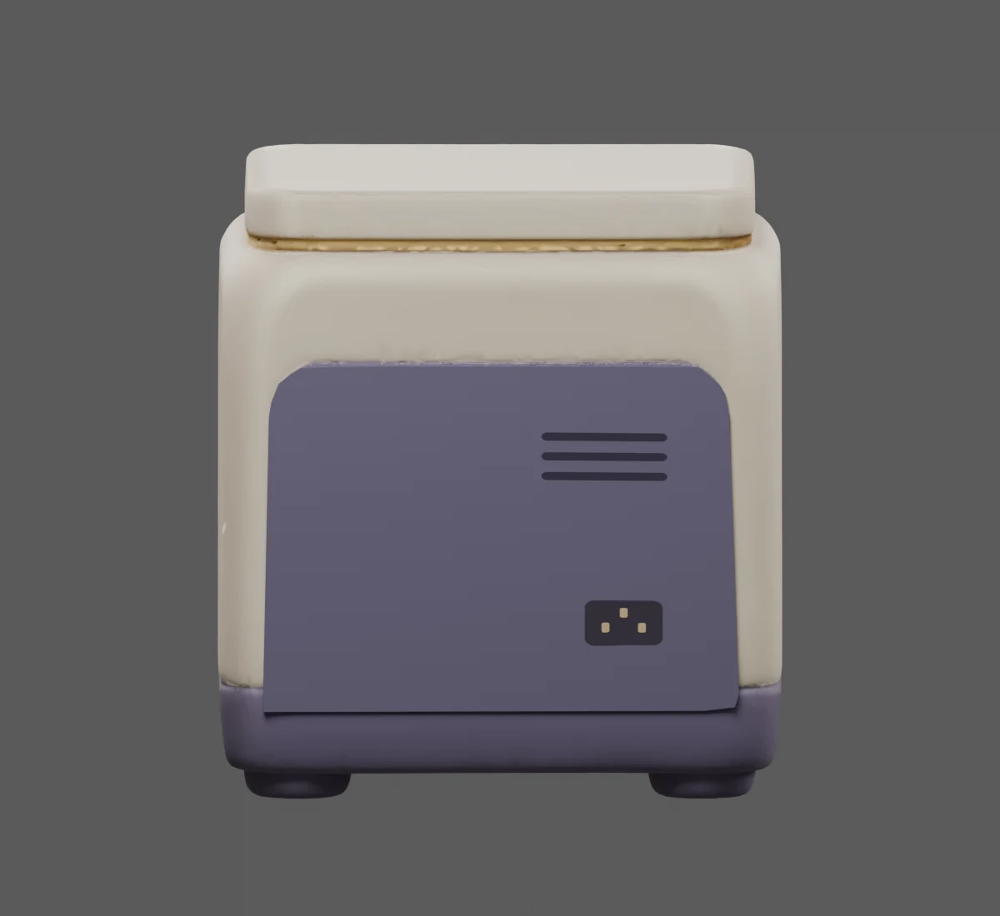
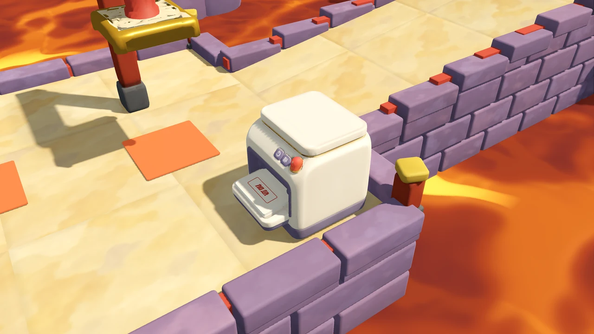
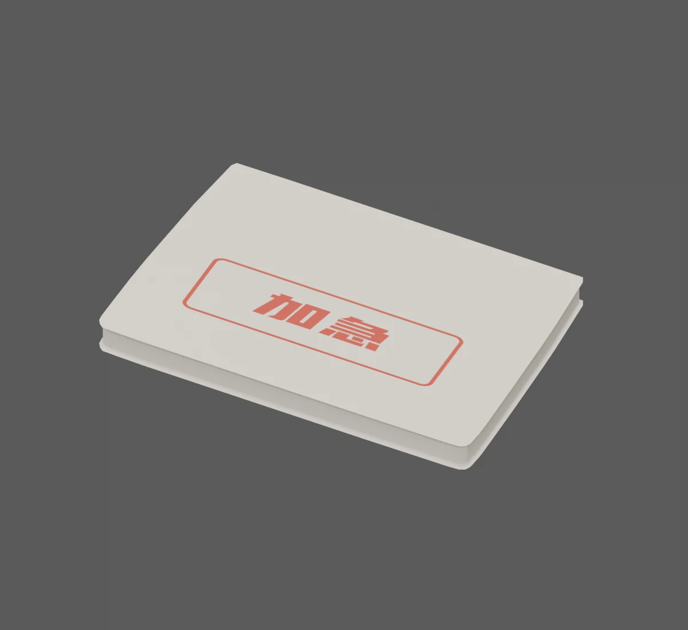

# 从三张参考图到坡顶机关：用 Lux3D 做催命打印机

在《地狱也得下班》第一层的 04 坡顶，玩家要认得这是一台办公室打印机，也要看得出下一叠加急文件会从哪儿飞出来。制作时我们把这两个问题拆开。三视图先定出纸口的形状，Blender 再把机身和会飞的纸包做成两个能独立控制的模型。

## 三视图和实际输入

设计时要求三面同尺度、同基线。正面定出纸口的宽度，右侧定托盘伸出的距离，背面只留检修板。这条约束让绘图和后面的模型检查有了相同的参照。[完整设计提示词](printer-design-prompt.txt)

> Create ONE coherent "催命打印机" (deadline printer) design in three exact orthographic elevations: FRONT, RIGHT SIDE, BACK, placed left-to-right at the same scale and baseline.

这段文字用于绘制上面的设计稿。选定 v001 后，实际提交给 Lux3D 的 `imgs` 是三张单独裁切的图。生成任务号为 **5948358**，版本为 `G1`，目标面数为 `150000`，请求输出 `glb` 和 `zip`。可分别查看三张输入图的展示副本。[正面](images/input-front.webp) · [右侧](images/input-right.webp) · [背面](images/input-back.webp)

## 从原模到两个游戏模型

背面是修整时最容易看出差别的地方。原模的检修板下缘有两处不规则色块。Blender 第五次修整保留生成的机壳，重新整理背板布线和表面，同时保住正面托盘的边缘。

| Lux3D 原模背面 | Blender 修整后的同向视图 |
| --- | --- |
|  |  |

把纸面展开为平面 UV 后，「加急」章能落在顶张中央。机身原点取地面中心，出纸口留 `PaperExit` 定位点，局部前方为 `+Z`。纸包另做网格，这样飞出的文件可以脱离托盘，机关仍留在原地。

| 游戏用导出件 | 实际三角形数 | 用途 |
| --- | ---: | --- |
| `printer-runtime.glb` | 22,467 | 固定机身、托盘和出纸定位 |
| `paper-packet.glb` | 384 | 可独立生成和移动的文件包 |

| 机身和托盘，v004 场景资产预览 | 独立飞行纸包 |
| --- | --- |
|  |  |

11 月 16 日的 Godot 候选工程里可以找到两个模型和纸包逻辑。上图留存的是较早的静态摆位。当前坡顶的发射时机、镜头内预警能否看清，以及三个角色实际躲避的手感，留待同版手动试玩取证。

[三角色资产索引](characters.md) · [素材使用条件](../../RIGHTS.md) · [返回首页](../../README.md)
